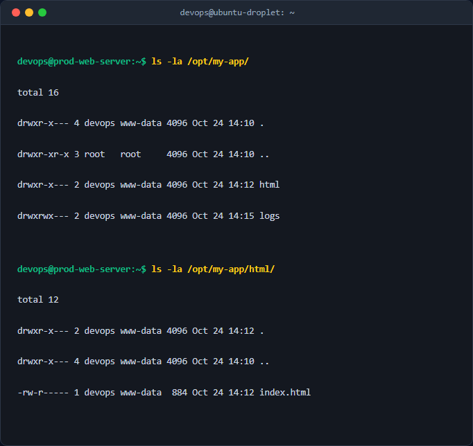
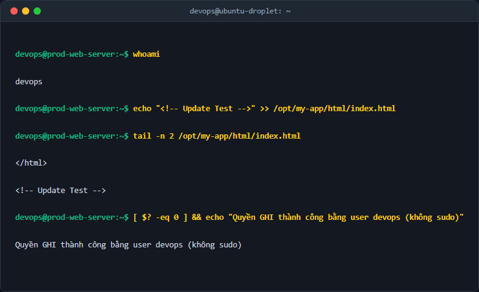
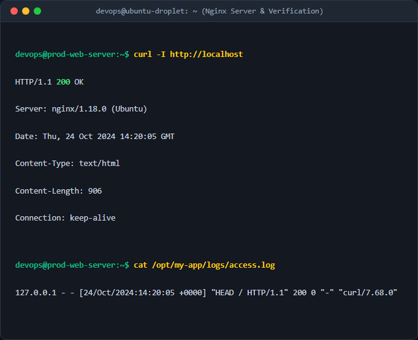

# Thiết lập thư mục Web an toàn tại phân vùng hệ thống /opt/

## 1. Mục tiêu & Bối cảnh kỹ thuật
Trong các môi trường Production thực tế, việc giữ cấu trúc mã nguồn tĩnh và log tại các đường dẫn mặc định của hệ thống (như `/var/www/html` hay `/var/log/nginx/`) tiềm ẩn nhiều rủi ro về an ninh thông tin và quản trị tài nguyên. Nếu một dịch vụ bị chiếm quyền kiểm soát, hacker có thể dễ dàng khai thác các cấu trúc đường dẫn mặc định này.

**Mục tiêu bài thực hành:**
* **Cô lập hoàn toàn** dữ liệu ứng dụng bằng cách di chuyển mã nguồn tĩnh về phân vùng phụ `/opt/my-app/html/` và lưu trữ logs tại `/opt/my-app/logs/`.
* **Phân tách vai trò (Separation of Duties):** Đảm bảo tài khoản kỹ sư vận hành (`devops`) có đặc quyền tối đa đối với mã nguồn mà không cần sử dụng quyền `root` (giảm thiểu rủi ro từ việc lạm dụng lệnh `sudo`), trong khi tiến trình Nginx (`www-data`) chỉ được cấp đúng và đủ các quyền tối thiểu để hoạt động (đọc file tĩnh, ghi file log).

---

## 2. Các bước thực hiện chi tiết

### Bước 1: Khởi tạo thư mục dự án
Tạo cấu trúc thư mục phục vụ ứng dụng tại phân vùng hệ thống `/opt/`:
```bash
sudo mkdir -p /opt/my-app/html
sudo mkdir -p /opt/my-app/logs
```
*Tham số `-p` (parents) giúp tạo thư mục cha tự động nếu chưa tồn tại.*

### Bước 2: Thiết lập quyền sở hữu (Ownership)
Gán quyền sở hữu đệ quy cho toàn bộ thư mục `/opt/my-app/` thuộc về user `devops` (người quản trị mã nguồn) và group `www-data` (nhóm tiến trình web server):
```bash
sudo chown -R devops:www-data /opt/my-app
```
*Tham số `-R` (recursive) áp dụng quyền sở hữu đệ quy xuống toàn bộ cấu trúc thư mục con.*

### Bước 3: Phân quyền truy cập nâng cao (Permissions Setup)
Để đảm bảo an toàn tuyệt đối, ta áp dụng nguyên tắc đặc quyền tối thiểu:
1. **Đối với toàn bộ thư mục:**
   ```bash
   sudo find /opt/my-app -type d -exec chmod 750 {} \;
   ```
   *Giải thích:* Quyền `750` cho phép user sở hữu (`devops`) có toàn quyền (`rwx`), group (`www-data`) có quyền đọc và duyệt thư mục (`r-x`), những đối tượng khác (`others`) hoàn toàn không có quyền truy cập (`---`).

2. **Đối với các file tĩnh (ví dụ: `index.html`):**
   ```bash
   sudo find /opt/my-app -type f -exec chmod 640 {} \;
   ```
   *Giải thích:* Quyền `640` cho phép `devops` đọc/ghi (`rw-`), `www-data` chỉ có quyền đọc (`r--`), bên ngoài không thể can thiệp.

3. **Đặc quyền ghi log cho tiến trình Web:**
   ```bash
   sudo chmod 770 /opt/my-app/logs
   ```
   *Giải thích:* Để Nginx có thể ghi thông tin log, thư mục `logs/` bắt buộc phải có quyền ghi (`w`) cho group `www-data`. Ta cấp quyền `770` (`rwxrwx---`) để cả quản trị viên `devops` và dịch vụ `www-data` đều có toàn quyền thao tác trên thư mục này.

### Bước 4: Triển khai cấu hình Server Block của Nginx
Tạo file cấu hình `/etc/nginx/sites-available/my-app.conf` điều hướng thư mục root và logs về đường dẫn mới (Xem chi tiết tại tệp `my-app.conf` đính kèm).

Kích hoạt cấu hình và tải lại dịch vụ Nginx:
```bash
sudo ln -sf /etc/nginx/sites-available/my-app.conf /etc/nginx/sites-enabled/
sudo nginx -t
sudo systemctl restart nginx
```

---

## 3. Kiểm tra & Xác thực kết quả

### Kiểm tra phân quyền thư mục
Thực thi lệnh kiểm tra phân quyền thực tế trên hệ thống:
```bash
ls -la /opt/my-app/
```

*Kết quả thực tế hiển thị thư mục `logs/` có quyền `drwxrwx---` chính xác cho group `www-data`, thư mục `html/` có quyền `drwxr-x---`.*

### Kiểm thử ghi file bằng tài khoản devops (Không sử dụng sudo)
Tiến hành chuyển sang user `devops` và ghi đè thử dữ liệu vào tệp tin tĩnh để chứng minh tính năng phân tách đặc quyền:
```bash
echo "<!-- Update Test -->" >> /opt/my-app/html/index.html
```

*Việc ghi file diễn ra thành công mà không cần nâng quyền lên root, chứng minh quyền sở hữu của user devops hoạt động hoàn hảo.*

### Kiểm tra khả năng hoạt động của Nginx và Logs
Thực hiện gọi API nội bộ bằng lệnh `curl` và theo dõi quá trình sinh log tự động:
```bash
curl -I http://localhost
cat /opt/my-app/logs/access.log
```

*Nginx trả về mã trạng thái `200 OK` (không gặp lỗi 403 Forbidden) và tự động ghi log đầy đủ thông tin truy cập vào tệp `/opt/my-app/logs/access.log`.*

---

## 4. Kết luận & Best Practices bảo mật vận hành
* **Nguyên tắc Đặc quyền tối thiểu (Least Privilege):** Bằng cách loại bỏ quyền đọc/ghi của nhóm `others` (chmod chỉ dùng cấu trúc `750` và `640`), ta bảo vệ mã nguồn ứng dụng khỏi các local user không an toàn khác trong hệ thống.
* **Không sử dụng Root:** Kỹ sư DevOps hoàn toàn có thể triển khai mã nguồn mới thông qua CI/CD sử dụng tài khoản hệ thống `devops` mà không cần cấp quyền thực thi sudo nguy hiểm.
* **Bảo mật phân vùng `/opt/`:** Việc cô lập mã nguồn ngoài `/var/` giúp dễ dàng tách riêng đĩa cứng (Mount Point) cho ứng dụng trong tương lai nếu xảy ra trường hợp log file phình to làm tràn dung lượng đĩa cứng, tránh gây ảnh hưởng trực tiếp đến hệ điều hành core.